# Graph Plotter — Architecture Guide

> **Who this is for:** anyone joining the team who wants to understand how the app works end to end before changing it. It assumes basic HTML/CSS/JavaScript knowledge and nothing else.
>
> **How to read it:** Sections 1–3 give you the big picture in five minutes. Section 4 walks through exactly what happens when a user uploads a CSV. Sections 5–7 are reference material (functions, data shapes, rendering math). Section 9 lists known problems and suggested fixes.

---

## 1. The app at a glance

Graph Plotter is a **static, client-side web app**. A user picks a CSV file and the app draws two of its numeric columns as a **scatter plot** or a **line graph** on an HTML `<canvas>`.

| Property | What it means for you |
|---|---|
| No backend | No server, no API, no database. The CSV never leaves the user's computer. |
| No build step | No npm, no bundler, no framework. Files in `src/` are exactly what the browser runs. |
| No libraries | CSV parsing and chart drawing are both hand-written (~280 lines of JS total). |
| Plain `<script>` tags | Everything shares the global scope. Load order matters: `parser.js` must come before `app.js`. |
| Canvas, not SVG | Fast with many points, but the chart is pixels. There are no DOM elements per data point, so hover detection is done manually in JS. |

---

## 2. File map

```
graph-plotter-enhanced/
├── src/                     ← the entire app (this folder is what gets deployed)
│   ├── index.html           UI skeleton: controls, <canvas>, tooltip, status/error text
│   ├── style.css            Layout + visual styling (canvas is 100% wide × 480px tall)
│   ├── parser.js            parseCSV(text) — pure function, no DOM access
│   └── app.js               Everything else: state, loading, drawing, events
├── docs/                    Requirements, dev guide, meeting notes, this file
├── .github/workflows/
│   └── static.yml           Deploys ./src to GitHub Pages on every push to main
├── README.md                Team roster + how to run locally
└── CONTRIBUTING.md          Branch/commit/PR conventions
```

---

## 3. Mental model: "frontend" vs "backend" in an app with no server

There is no server, but the code still splits into the same layers you'd expect:

```
┌──────────────────────────────────────────────────────────────────────┐
│  UI LAYER  (index.html + style.css)                                  │
│  <input #file>  <button #sample>  <select #xs #ys #type>  <input     │
│  #title>  <button #dl>  <canvas #cv>  <div #tooltip>  <p #status/#err>│
└───────────────┬───────────────────────────────────▲──────────────────┘
                │ DOM events                        │ canvas pixels,
                │ (change, click, input, drop,      │ textContent, innerHTML,
                │  mousemove, resize)               │ tooltip style
┌───────────────▼───────────────────────────────────┴──────────────────┐
│  CONTROLLER  (event handlers, bottom of app.js)                      │
│  FileReader → load()        control changes → draw()                 │
└───────────────┬──────────────────────────────────────────────────────┘
                │
┌───────────────▼──────────────────────────────────────────────────────┐
│  "BACKEND" / DATA LOGIC                                              │
│  parseCSV()  (parser.js)  text → string[][]                          │
│  load()      (app.js)     headers, rows, numeric-column detection    │
│  draw()      (app.js)     points, scales, rendering                  │
│  niceTicks(), fmt()       axis helpers                               │
└──────────────────────────────────────────────────────────────────────┘
```

### Key connection points

These are the places where one layer hands off to another. If something breaks between "I clicked a thing" and "the chart changed", the cause is almost always at one of these seams.

| # | Connection | Where | Notes |
|---|---|---|---|
| 1 | HTML → JS load order | [index.html:40-41](../src/index.html#L40-L41) | `parser.js` defines global `parseCSV`; `app.js` calls it. Swap the order and you get `parseCSV is not defined`. |
| 2 | File input → FileReader → `load()` | [app.js:222-231](../src/app.js#L222-L231) | Async: `load()` runs in `reader.onload`, after the file has been read. |
| 3 | Drag-and-drop → FileReader → `load()` | [app.js:213-219](../src/app.js#L213-L219) | Same path as #2, triggered by dropping a file on the chart area. |
| 4 | Sample button → `load()` | [app.js:233-240](../src/app.js#L233-L240) | Generates CSV *text* in memory, so it goes through the exact same pipeline as a real file. |
| 5 | `load()` → `parseCSV()` | [app.js:30](../src/app.js#L30) | The only call into `parser.js`. |
| 6 | `load()` → dropdowns (`innerHTML`) | [app.js:49-53](../src/app.js#L49-L53) | JS writes the list of numeric columns into the `<select>` elements. |
| 7 | Controls → `draw()` | [app.js:242-244](../src/app.js#L242-L244) | X/Y/type `onchange`, title `oninput`, and window `resize` all call `draw()` directly. |
| 8 | **DOM → `draw()` (reading state)** | [app.js:73](../src/app.js#L73), [app.js:116](../src/app.js#L116) | `draw()` takes no arguments. It reads the selected columns, chart type and title **from the DOM** each time. The dropdowns are the source of truth for what gets plotted. |
| 9 | `draw()` → `cachedPlot` → hover handler | [app.js:123](../src/app.js#L123), [app.js:162-191](../src/app.js#L162-L191) | `draw()` saves the points and pixel-scale functions so the `mousemove` handler can find the nearest point without redrawing. |
| 10 | `draw()` → canvas → Download PNG | [app.js:246-254](../src/app.js#L246-L254) | The download copies whatever is currently on the canvas onto a white background. |

---

## 4. Walkthrough: what happens when a user uploads a CSV

Imagine you are the user. You click **Choose File** and select `weather.csv`:

```
date_index,temperature,humidity,city
0,12.5,80,Paris
1,13.1,78,Paris
...
```

### Sequence diagram

```mermaid
sequenceDiagram
    actor User
    participant Input as <input #file>
    participant FR as FileReader
    participant Load as load()
    participant Parse as parseCSV()
    participant DOM as Dropdowns / #err
    participant Draw as draw()
    participant Canvas as <canvas #cv>

    User->>Input: selects weather.csv
    Input->>FR: onchange → readAsText(file)
    FR-->>Load: onload → load(text, "weather.csv")
    Load->>Parse: parseCSV(text)
    Parse-->>Load: string[][] (all rows incl. header)
    Load->>Load: split headers / rows, detect numeric columns
    alt fewer than 2 numeric columns
        Load->>Canvas: clearChart("Need at least two numeric columns.")
        Load->>DOM: #err = error message
    else OK
        Load->>DOM: fill #xs / #ys, preselect first two numeric cols
        Load->>Draw: draw()
        Draw->>DOM: read #xs, #ys, #type, #title
        Draw->>Draw: build pts, compute bounds, ticks, margins, scales
        Draw->>Draw: cachedPlot = { pts, sx, sy, ... }
        Draw->>Canvas: grid, tick labels, axis labels, title, data
        Draw->>DOM: #status = "weather.csv: N rows, M points plotted."
    end
```



### Step by step

**Step 1: Reading the file** ([app.js:222-231](../src/app.js#L222-L231))
The `<input type="file">` fires `onchange`. A `FileReader` reads the file **as text**, which is asynchronous. When it finishes, `reader.onload` calls `load(reader.result, f.name)`. The input's value is then cleared so that choosing the same file again still fires `onchange`.

**Step 2: Parsing** ([parser.js](../src/parser.js))
`parseCSV(text)` walks the text one character at a time with a small state machine (`inQuotes` true/false):
- Strips a leading BOM (``, added by Excel).
- Outside quotes, `,` ends a field and `\n`, `\r\n` or `\r` ends a row.
- Inside quotes, commas and newlines are kept literally, and `""` becomes `"`.
- Completely empty lines are skipped.

It returns an **array of rows, where each row is an array of strings**. No type conversion happens here. Every value is still text.

**Step 3: Validating and finding numeric columns** ([app.js:28-47](../src/app.js#L28-L47))
1. Clear `#err`.
2. If there are fewer than 2 rows (header + at least one data row), show "No data rows found." and stop.
3. `headers` ← first row, trimmed. Blank headers become `col1`, `col2`, …
   `rows` ← every row after the header. `fileName` ← the file name.
4. **Numeric detection:** for each column, take its non-empty values in the first 500 data rows. The column counts as numeric if **at least 80%** of them pass `!isNaN(Number(v))`. In the example, `date_index`, `temperature` and `humidity` qualify and `city` does not.
5. If fewer than 2 columns qualify, show "Need at least two numeric columns." and stop.

**Step 4: Populating the controls** ([app.js:49-54](../src/app.js#L49-L54))
One `<option>` is built per numeric column. Its `value` is the **column index**, not the column name. The same option list goes into both `#xs` and `#ys`. X defaults to the first numeric column and Y to the second. Then `draw()` is called.

**Step 5: Drawing** ([app.js:71-159](../src/app.js#L71-L159)). `draw()` is the core of the app and runs in this order:

| Phase | Lines | What happens |
|---|---|---|
| Read state | [73](../src/app.js#L73) | `xi`, `yi` (column indices) and `type` are read from the dropdowns. |
| Build points | [75-79](../src/app.js#L75-L79) | Each row becomes `[Number(x), Number(y)]`. Rows with empty or non-finite values are skipped. Note that **non-numeric rows in a "numeric" column are silently dropped here.** |
| Empty check | [80-83](../src/app.js#L80-L83) | No valid points → show an error and stop. |
| Sort (line only) | [85](../src/app.js#L85) | Line charts sort points by X so the line runs left to right. |
| Size canvas | [88-91](../src/app.js#L88-L91) | The backing bitmap is set to CSS size × `devicePixelRatio`, so the chart stays sharp on retina screens. Resizing the bitmap also clears it. |
| Data bounds | [94-105](../src/app.js#L94-L105) | A loop finds min/max (deliberately *not* `Math.min(...pts)`, which overflows the call stack on huge arrays). A zero range is widened by ±1. Then 4% padding is added on X and 6% on Y. |
| Margins | [108-117](../src/app.js#L108-L117) | The left margin grows to fit the widest Y tick label. The top margin is larger when there is a title. |
| Scales | [119-120](../src/app.js#L119-L120) | `sx(x)` and `sy(y)` turn data values into pixel positions (see §7). |
| Cache | [123](../src/app.js#L123) | `cachedPlot` is saved for the hover tooltip. |
| Grid + ticks | [125-136](../src/app.js#L125-L136) | `niceTicks()` picks round tick values, which are drawn as grid lines plus `fmt()` labels. |
| Labels | [139-143](../src/app.js#L139-L143) | X label at the bottom, Y label rotated 90°, optional bold title at the top. |
| Data | [146-156](../src/app.js#L146-L156) | **Line:** one path through all points. **Scatter:** one circle per point; above 1,000 points the alpha drops to 0.45, and above 5,000 the radius shrinks from 4px to 2px. |
| Status | [158](../src/app.js#L158) | e.g. "weather.csv: 365 rows, 365 points plotted." |

**Step 6: Interaction.** The data is now loaded and drawn. Nothing else runs until the next event:
- Change X, Y or chart type, type in the title box, or resize the window → `draw()` runs again from scratch. The CSV is **not** re-parsed, but every row is converted with `Number()` again.
- Move the mouse over the canvas → the hover handler uses `cachedPlot` (see §5).

---

## 5. Other flows

| Flow | Trigger | Path |
|---|---|---|
| **Startup** | Page load | The last line of `app.js` ([256](../src/app.js#L256)) programmatically clicks **Use sample data**, so a chart appears straight away. |
| **Sample data** | `#sample` click | Builds a 200-row CSV string (`day, temperature, sales`, a sine wave plus noise) → `load(csv, 'sample.csv')`. Same pipeline as a real upload. |
| **Drag & drop** | Drop a file on `#chart-wrap` | `dragenter`/`dragover` add the `.drag-over` class (dashed blue border). `dragleave`/`drop` remove it. `drop` reads the first file with `FileReader` → `load()`. Note: `drop` has **two** listeners, one for the styling ([206-211](../src/app.js#L206-L211)) and one for loading ([213-219](../src/app.js#L213-L219)). |
| **Hover tooltip** | `mousemove` on canvas | Scans **every** point in `cachedPlot.pts`, converts each to pixels with `sx`/`sy`, and keeps the nearest one within 10px (`d² < 100`). The `#tooltip` div is then positioned absolutely at that pixel. This works because `.chart-container` is `position: relative` ([style.css:115-118](../src/style.css#L115-L118)). `mouseleave` hides it. |
| **Download PNG** | `#dl` click | Creates an off-screen canvas of the same bitmap size, fills it white, draws the visible canvas on top, then triggers a download of `chart.png` via a temporary `<a download>`. The white fill matters because the visible canvas is transparent (its white background comes from CSS, which isn't part of the bitmap). |
| **Error display** | Any validation failure | `clearChart(msg)` ([12-25](../src/app.js#L12-L25)) wipes the canvas and writes the message in the middle. `#err` shows the message in red. |

---

## 6. Key functions reference

| Function | File | Signature | Responsibility | Side effects |
|---|---|---|---|---|
| `parseCSV` | parser.js | `(text: string) → string[][]` | RFC-4180-ish CSV parsing | None (pure). Easy to unit test. |
| `load` | app.js | `(text: string, name: string) → void` | Parse, validate, detect numeric columns, fill dropdowns, trigger first draw | Writes `headers`, `rows`, `fileName`, dropdown HTML, `#err`. Calls `draw()`. |
| `draw` | app.js | `() → void` | Build points, compute scales, render everything | Resizes and repaints the canvas, writes `cachedPlot`, `#err`, `#status`. |
| `clearChart` | app.js | `(msg?: string) → void` | Blank the canvas and optionally center a message | Resizes and clears the canvas. |
| `niceTicks` | app.js | `(min, max, count = 6) → number[]` | Choose "round" tick values using a 1-2-5-10 step | None. |
| `fmt` | app.js | `(v: number) → string` | Format a number to 5 significant digits for labels and tooltips | None. |
| `$` | app.js | `(id: string) → HTMLElement` | Shorthand for `document.getElementById` | None. |

---

## 7. Data structures and state

### 7.1 How the data changes shape

```
File (bytes on disk)
   │  FileReader.readAsText
   ▼
text: string                         "day,temperature,sales\n0,10.5,123.4\n..."
   │  parseCSV
   ▼
all: string[][]                      [["day","temperature","sales"],
                                      ["0","10.5","123.4"], ...]
   │  load(): split header / body
   ▼
headers: string[]                    ["day","temperature","sales"]
rows:    string[][]                  [["0","10.5","123.4"], ...]     ← still strings!
numeric: number[]  (local)           [0, 1, 2]   (column indices)
   │  user selection → xi, yi (column indices, read from <select>.value)
   │  draw()
   ▼
pts: [number, number][]              [[0, 10.5], [1, 11.2], ...]     ← finally numbers
   │  sx / sy
   ▼
canvas pixels
```

Two things to keep in mind:
1. **Columns are always referenced by index** (`xi`, `yi`, option `value`), never by name. Duplicate header names are therefore fine.
2. **`rows` holds strings.** Conversion to numbers happens inside `draw()` and is repeated on every redraw.

### 7.2 Global (module-level) state in `app.js`

| Variable | Type | Set by | Read by | Meaning |
|---|---|---|---|---|
| `headers` | `string[]` | `load()` | `draw()`, hover | Column names (blank → `colN`) |
| `rows` | `string[][]` | `load()` | `draw()`, download | Data rows, header excluded. `rows.length === 0` means "nothing loaded". |
| `fileName` | `string` | `load()` | `draw()` (status line) | Shown in `#status` |
| `cachedPlot` | object (below) | `draw()` | `mousemove` handler | Snapshot of the last successful render |
| `cv`, `ctx` | canvas / 2D context | startup | everywhere | The single drawing surface |
| `COLOR`, `GRID`, `TEXT`, `MUTED` | string constants | startup | drawing code | The color palette |

**State that lives in the DOM rather than in JS variables:** selected X column (`#xs.value`), selected Y column (`#ys.value`), chart type (`#type.value`), and title (`#title.value`). `draw()` reads these every time it runs.

### 7.3 `cachedPlot`: the object shared between rendering and hover

Defined at [app.js:8](../src/app.js#L8), overwritten at [app.js:123](../src/app.js#L123):

```js
cachedPlot = {
  pts,      // [x, y][]           the exact points that were drawn (sorted by x for line charts)
  sx,       // (x: number) => px  data X → canvas X (CSS pixels)
  sy,       // (y: number) => px  data Y → canvas Y (CSS pixels)
  xi, yi,   // number             column indices used, for tooltip labels via headers[xi]
  L, T,     // number             left / top margin in px
  pw, ph,   // number             plot-area width / height in px
  W, H      // number             canvas CSS width / height
}
```

> The initial value at line 8 has a different shape (`x0, x1, y0, y1` and no `L/T/pw/ph/W/H`). Only `pts`, `sx`, `sy`, `xi` and `yi` are actually read. The rest is unused today, but it would be useful for future zoom/pan work.

### 7.4 Coordinate mapping (the core math in `draw()`)

```
            ←──────────────────── W (canvas CSS width) ───────────────────→
        ┌──────────────────────────────────────────────────────────────────┐ ↑
        │                         T (20px, or 40px with a title)           │ │
        │      ┌───────────────────────────────────────────────────┐       │ │
        │  L   │                                                   │  R    │ │
        │(≥50, │              plot area  pw × ph                   │(24px) │ H
        │ fits │                                                   │       │ │
        │ Y    │                                                   │       │ │
        │labels└───────────────────────────────────────────────────┘       │ │
        │                         B (50px: tick labels + X label)          │ │
        └──────────────────────────────────────────────────────────────────┘ ↓

  sx(x) = L + (x − x0) / (x1 − x0) · pw
  sy(y) = T + ph − (y − y0) / (y1 − y0) · ph      ← flipped: canvas Y grows downward
```

All drawing uses **CSS pixels**. `ctx.setTransform(dpr, …)` takes care of scaling up to device pixels, which is why mouse coordinates from `getBoundingClientRect()` can be compared directly against `sx`/`sy` output.

---

## 8. Running and deploying

- **Locally:** open `src/index.html` directly, or run `python3 -m http.server 8000 --directory src` and visit `http://localhost:8000`.
- **Deployment:** [.github/workflows/static.yml](../.github/workflows/static.yml) uploads `./src` to **GitHub Pages** on every push to `main` (it can also be triggered manually).
- **Tests:** none yet. `parser.js` has no DOM dependencies, so it can be tested in Node, e.g. `node -e "eval(require('fs').readFileSync('src/parser.js','utf8')); console.log(parseCSV('a,b\n1,2'))"`.
- **Debugging:** open DevTools (F12). Most problems show up as console errors or red text in `#err`.

---

## 9. Known issues and suggested changes

These came out of reviewing the code while writing this guide. No code has been changed yet. Items marked ✅ were reproduced by actually running the code.

### 9.1 Bugs and logic errors (high priority)

**A. A failed load leaves the app in a mixed old/new state.** [app.js:35-47](../src/app.js#L35-L47)
`load()` overwrites `headers`, `rows` and `fileName` *before* checking that the new file has 2 numeric columns. If that check fails, the canvas is cleared, but:
- the dropdowns still list the **old** file's columns (by index),
- `cachedPlot` still holds the **old** points, so hovering the blank canvas shows tooltips for invisible points, labelled with the **new** file's header names,
- any later resize, title keystroke or dropdown change calls `draw()`, which plots the **new** rows using the **old** column indices.

*Repro:* the sample data loads on startup → upload `name,score\nA,1\nB,2` → the error appears → hover where the old points were → a tooltip like `name: 57, score: 12.3` appears on an empty chart.
*Fix:* parse and validate into local variables and only assign the globals once validation passes. Also reset `cachedPlot.pts = []` in `clearChart()`.

**B. ✅ Whitespace-only cells are plotted as `0`.** [app.js:78](../src/app.js#L78)
The check is `r[xi] !== ''`, but `Number(' ') === 0`. So `x,y\n1, \n2,5` plots the point `(1, 0)`. The numeric-detection step *does* trim, so the two checks disagree.
*Fix:* use `r[xi]?.trim() !== ''` (or trim once at parse/load time).

**C. ✅ `niceTicks()` can loop forever and freeze the tab.** [app.js:65](../src/app.js#L65)
When values are large and nearly constant (e.g. a column of IDs around `1e17` that differ by 16, or nanosecond timestamps spanning a few hundred ns), the tick `step` becomes smaller than floating-point precision at that size. `v += step` then leaves `v` unchanged, and the loop never ends while it keeps pushing to an array.
*Fix:* compute ticks as `start + i * step` for `i < maxTicks` (e.g. 50), or bail out when `v + step === v`.

**D. ✅ A stray quote inside an unquoted field swallows the rest of the file.** [parser.js:15](../src/parser.js#L15)
Any `"` switches the parser into quoted mode, even mid-field. For example `5" tall,1\n2,3\n4,5` becomes **one** field containing everything after it. Real-world CSVs (measurements in inches, free-text notes) can hit this.
*Fix:* only enter quoted mode when the quote is the first character of a field (`field === ''`). Otherwise treat it as a literal character.

**E. No `FileReader` error handling.** [app.js:216](../src/app.js#L216), [app.js:225](../src/app.js#L225)
If reading fails, nothing happens and the user gets no message. Add `reader.onerror = () => $('err').textContent = 'Could not read file.'`.

**F. Dropping a file outside the chart area navigates away from the app.** Only `#chart-wrap` calls `preventDefault()`. If the drop misses it, the browser opens the CSV as a page and the current chart is lost. Add `dragover`/`drop` `preventDefault()` listeners on `window`.

### 9.2 Security

**G. HTML injection / XSS through CSV header names.** [app.js:49-51](../src/app.js#L49-L51)
Header text is inserted with `innerHTML`, without escaping. A CSV whose header is `` runs script in the app's origin as soon as it's opened. This matters if people share CSVs with each other. Even harmless headers like `x<y` or `a</option>b` corrupt the dropdown.
*Fix:* build options safely:
```js
for (const j of numeric) sel.add(new Option(headers[j], j));
```
Everywhere else (`#status`, `#err`, tooltip, canvas `fillText`) already uses safe APIs (`textContent` or canvas text). Keep it that way, and treat `innerHTML` with any CSV-derived text as a review red flag.

**H. No file-size guard.** Dropping a multi-GB file (or a binary file, since drag-and-drop ignores `accept=".csv"`) is read entirely into memory as a string and can crash the tab. Consider warning above roughly 100 MB and checking `f.name` / `f.type`.

### 9.3 Performance (matters as datasets grow)

| # | Bottleneck | Where | Suggestion |
|---|---|---|---|
| I | Every redraw re-converts every cell with `Number()`, including on **every title keystroke** and every resize event. | [app.js:76-79](../src/app.js#L76-L79), [242-244](../src/app.js#L242-L244) | Convert numeric columns once in `load()` (e.g. one `Float64Array` per column). Throttle redraws with `requestAnimationFrame` (a `scheduleDraw()` wrapper). |
| J | Hover scans **all** points on every `mousemove`, calling two closures per point. At 100k+ points this lags. | [app.js:173-181](../src/app.js#L173-L181) | Throttle with `requestAnimationFrame`. Build a simple grid/bucket index of pixel positions in `draw()` so hover only checks nearby cells. |
| K | Scatter calls `beginPath` + `arc` + `fill` once per point. | [app.js:154](../src/app.js#L154) | Batch all circles into one path and call `fill()` once. For small radii, `fillRect` is much faster than `arc`. |
| L | Line charts are never downsampled. With hundreds of thousands of points, most segments land on the same pixel column. | [app.js:147-150](../src/app.js#L147-L150) | Min/max-per-pixel-column decimation, or LTTB. |
| M | `parseCSV` builds every field with `field += c`, one character at a time. | [parser.js](../src/parser.js) | Track start/end indices and use `text.slice()`. This is noticeably faster for large files. |

### 9.4 Documentation drift

The existing [project-overview.md](project-overview.md) predates several changes and contradicts the code in places:

| Doc says | Reality |
|---|---|
| Deploys on Vercel; "GitHub Pages cannot serve from `/src`" | The repo deploys to **GitHub Pages** via Actions (`static.yml` uploads `./src`). |
| Known limitation: "No hover tooltip" | A hover tooltip is implemented. |
| Known limitation: `Math.min(...array)` can fail | Already fixed with a manual loop ([app.js:93-101](../src/app.js#L93-L101)). |
| Canvas height 460px | CSS sets 480px ([style.css:122](../src/style.css#L122)). |
| Repo structure lists `DEVELOPMENT_GUIDE.md` and `.github/pull_request_template.md` | Neither exists. The guide is `project-overview.md`, and `.github/` only contains `workflows/static.yml`. |
| Nothing about drag-and-drop | Drag-and-drop upload is implemented. |

Also: `docs/design.md` and `docs/progress-log.md` are empty, and CONTRIBUTING's Definition of Done says "Tests pass" although there are no tests. Adding a link to this guide from the README would help new members find it.

### 9.5 Small cleanups

- Give `cachedPlot` the same shape in its initial declaration (line 8) as in `draw()` (line 123).
- `clearChart()` and `draw()` repeat the canvas sizing/DPR code. Extract a `resizeCanvas()` helper.
- `draw()` is about 90 lines and mixes data preparation, layout and painting. Splitting it into `buildPoints()`, `computeLayout()` and `render()` would make the planned features easier to add and to test.

---

## 10. Where to make common changes

| I want to… | Touch these places |
|---|---|
| Add a chart type (e.g. the heatmap from the 2026-10-12 meeting notes) | Add an `<option>` to `#type` in index.html, then add a branch in the data-rendering section of `draw()` ([app.js:146-156](../src/app.js#L146-L156)). If it needs a different point layout, adjust the sort at [line 85](../src/app.js#L85). |
| Add a trendline toggle | Add a checkbox in index.html, register it alongside the other controls at [app.js:242](../src/app.js#L242), compute the regression from `pts` in `draw()`, and draw it after the data using `sx`/`sy`. |
| Tune scatter point size/alpha by point count | [app.js:152-153](../src/app.js#L152-L153) (the meeting notes suggest `alpha = Math.max(0.05, 1 / Math.sqrt(n))`). |
| Add zoom/pan | Store a view window (`x0..x1`, `y0..y1`) in state instead of always computing it from the data in `draw()`. `cachedPlot` already holds the plot-area geometry needed to invert mouse positions back to data values. |
| Support semicolon/tab-delimited files | Add a delimiter parameter to `parseCSV` (or auto-detect it from the header line). |
| Change colors | Constants at [app.js:4](../src/app.js#L4) for the canvas, and [style.css](../src/style.css) for the page. Keep the two in sync. |
